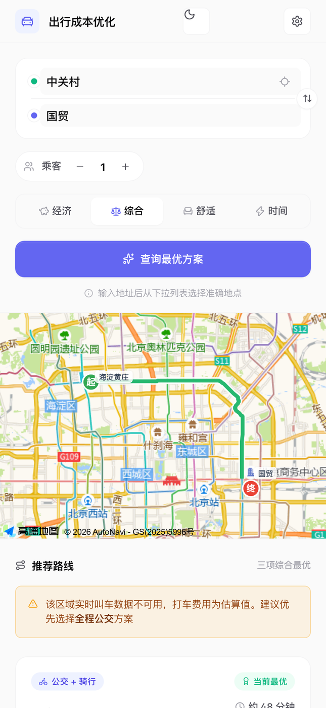
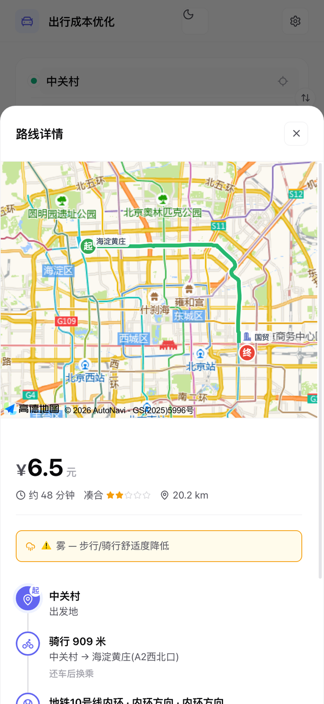

# 出行成本优化器

> 在地铁、公交、骑行、步行与打车之间自动组合，算出一趟出行里最省钱的那条路。



输入起点和终点，应用会同时查询全程公交/地铁、步行、骑行、打车，并自动生成「骑行/打车接驳 + 地铁主干」的混合方案，按费用、时间、舒适度打分排序，给出当前最优路线。

## 功能

- **起终点**：高德 POI 联想、地图选点、GPS 定位、起点终点互换
- **多模式路线**：全程公交/地铁、步行、骑行、打车
- **混合接驳**：骑行接驳、打车到站、出站打车、「打车 + 地铁 + 打车」；每条方案最多 2 段打车，避免退化为全程打车
- **四种排序**：经济 / 综合 / 舒适 / 时间
- **打车估价**：滴滴实时报价（可配置）→ 高德驾车估价 → 本地城市出租车规则（北京、上海、广州、深圳、杭州、成都），含夜间加价与远途返程费
- **舒适度**：按接驳方式、换乘次数、步行/骑行时长计算星级，并结合实时天气（温度、降雨、湿度）修正
- **细节**：多乘客人均价、结果 10 分钟内有效、历史搜索恢复、深浅色主题、离线访问、设置导入导出

## 排序是怎么算的

费用、时间、舒适度分别对当前候选集做 regret 归一化，再按模式加权；在此基础上叠加 Pareto 支配惩罚、可靠性惩罚（数据来源、绕行、拥堵）和「多花 X 元省 Y 分钟」的性价比惩罚。经济 / 时间模式主要放大对应权重，综合模式额外考虑性价比。

## 技术栈

原生 JavaScript（无框架、无打包器）、HTML5 / CSS3、高德地图 JS API、Node.js（Vercel Serverless 代理 + 本地开发服务器）、Service Worker（PWA）、`node:test`。

## 本地运行

```bash
git clone https://github.com/Koileo/travel-cost-optimizer.git
cd travel-cost-optimizer
npm run dev          # http://localhost:3000
```

无需安装依赖，要求 Node.js 18+。

可选：在仓库根目录创建 `.env`（已被 `.gitignore` 忽略）：

```ini
# 高德 Web 服务 Key，供服务端驾车代理 /amap-driving 使用；不配置时该接口返回 503
AMAP_WEB_SERVICE_KEY=

# 滴滴估价参数，全部可选；不配置时自动回退高德驾车估价与本地计价规则
DIDI_TOKEN=
DIDI_WSGSIG=
DIDI_SECDD_AUTH=
DIDI_DDFP=
DIDI_SEC_SESSION_ID=
DIDI_DFP_DDFP=
DIDI_CALL_CAR_PHONE_ENCODE=
```

前端使用的高德 JS API Key 位于 `index.html` 与 `01-state.js`，部署前请替换为自己的 Key 并配置域名白名单。

## 测试

```bash
npm test
```

`node:test` 共 37 个用例，覆盖路线组合与去重、接驳站选择、缓存 TTL、驾车降级、服务端静态资源白名单等。

## 部署

仓库内置 `vercel.json`，`app.js` 同时提供静态资源与两个代理接口（`/amap-driving`、`/didi-estimate`）。在 Vercel 导入仓库、配置上表环境变量即可。

## 目录结构

```
index.html            页面结构
styles.css            样式（移动优先，含深色主题）
01-state.js           全局状态与计价常量
02-utils.js           格式化、距离、本地出租车计价
03-algorithm.js       舒适度、Pareto、排序与筛选
04-map.js             地图、POI 联想、天气
05-didi.js            滴滴估价客户端（限流、缓存、熔断）
06-route.js           路线查询与混合方案生成
07-ui.js              结果渲染、详情弹窗、历史恢复
08-settings.js        设置面板与导入导出
09-sw.js              Service Worker 注册
app.js                Vercel / Node 入口：静态白名单 + 代理
dev-server.js         本地开发服务器
```

## 截图

| 主界面 | 推荐路线 | 路线详情 |
| --- | --- | --- |
|  |  |  |

## 说明

- 打车报价来自第三方接口，参数需自行获取，仅供学习研究，请遵守对应平台的服务条款。
- 所有价格为估算值，实际以平台结算为准。
- 项目自身不保存用户位置与搜索记录，搜索历史仅存于浏览器 `localStorage`。

## License

[MIT](LICENSE)
